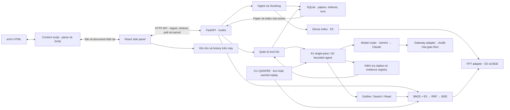

# Kiến trúc mã nguồn PaperLens

PaperLens là Chrome Extension Manifest V3 dùng React và TypeScript ở side panel, với một backend FastAPI. Người đọc phân tích trang arXiv HTML, hỏi về paper đang mở, kiểm tra trích dẫn và lưu ghi chú. CLI QASPER dùng cùng mã chunking, retrieval và agent để đánh giá. Bộ khung này đang ở giai đoạn đặc tả.

Phạm vi MVP, giới hạn và giao diện lấy theo kế hoạch v4.1. Bản thảo PDF mô tả phương pháp paragraph lineage, hybrid retrieval và agent có giới hạn. Chất lượng trả lời, hỗ trợ ngữ nghĩa của citation và độ trễ cần được đo khi có hệ thống chạy. [Kế hoạch v4.1](../PaperLens_Research_Project_Plan.md), [bản thảo PaperLens](../PaperLens_Arxiv_Paper.pdf)



## Cây thư mục

Dấu `*` đánh dấu file khai báo khi đóng gói extension. Mỗi file nguồn bắt đầu bằng một khối mô tả trách nhiệm và các điều kiện cần giữ khi triển khai.

```text
PaperLens/
├── .env                                       # Cấu hình backend cục bộ, Git bỏ qua
├── .env.example                                # Mẫu công khai khớp tên biến cấu hình backend
├── .gitignore                                 # Bỏ qua cấu hình riêng và file sinh tự động
├── PaperLens_Research_Project_Plan.md         # Phạm vi, protocol và roadmap v4.1
├── PaperLens_Arxiv_Paper.pdf                   # Bản thảo phương pháp
├── pyproject.toml                              # Đóng gói Python, phụ thuộc và cấu hình test
├── docs/
│   ├── architecture.md                         # Cây file, luồng dữ liệu và trách nhiệm
│   ├── fpt_api_contract.md                     # Ghi hợp đồng API theo từng model FPT
│   └── llm_gateway_contract.md                 # Ghi hợp đồng generation, tools và usage theo alias
├── extension/
│   ├── manifest.json *                         # Manifest V3, entrypoints và quyền Chrome
│   ├── package.json *                          # Phụ thuộc React, TypeScript, esbuild và lệnh build
│   ├── tsconfig.json *                         # Kiểm tra kiểu TS/TSX và Chrome APIs
│   ├── build.mjs                               # Bundle ba entrypoint rồi chép manifest và HTML
│   ├── src/
│   │   ├── messages.ts                         # Kiểu message giữa side panel và content script
│   │   ├── background/
│   │   │   └── index.ts                        # Mở side panel từ toolbar
│   │   ├── content/
│   │   │   ├── index.ts                        # Nhận yêu cầu context, Analyze và Jump
│   │   │   ├── parser.ts                       # Nhận diện trang và lấy outline, paragraphs
│   │   │   └── navigation.ts                   # Tạo fingerprint và xác minh vị trí trước khi Jump
│   │   ├── api/
│   │   │   ├── types.ts                        # Kiểu request/response phản ánh FastAPI schema
│   │   │   └── client.ts                       # Gọi FastAPI từ side panel với token phiên
│   │   └── sidepanel/
│   │       ├── index.html                      # Trang Chrome nạp vào side panel
│   │       ├── main.tsx                        # Điểm khởi tạo React
│   │       ├── App.tsx                         # Màn hình hỏi paper, trạng thái và thao tác
│   │       ├── usePaper.ts                    # Tab hiện tại, consent, ingest và polling chỉ mục
│   │       ├── useAgentRun.ts                 # Bắt đầu, theo dõi và hủy lượt hỏi
│   │       ├── Answer.tsx                     # Câu trả lời theo block và liên kết citation
│   │       ├── EvidenceList.tsx               # Đoạn trích, section, Jump và Save
│   │       ├── library.ts                     # History, ghi chú local và xuất Markdown
│   │       └── styles.css                     # Kiểu trình bày side panel và highlight citation UI
│   └── tests/
│       ├── arxiv_dom.test.ts                  # Parser, anchor, fingerprint và section fallback
│       └── sidepanel.test.ts                  # Consent, đổi tab, poll/cancel và lưu/xuất
├── backend/
│   ├── app/
│   │   ├── main.py                            # FastAPI app, vòng đời tài nguyên và health
│   │   ├── ingest.py                          # Validate paper, băm nội dung và lập chỉ mục
│   │   ├── routes/
│   │   │   ├── papers.py                      # Ingest, đọc trạng thái và xóa paper
│   │   │   ├── retrieve.py                   # Endpoint lấy evidence độc lập
│   │   │   ├── agent.py                      # Endpoint bắt đầu, đọc và hủy agent run
│   │   │   └── session.py                    # Trạng thái phiên và quota của người dùng
│   │   ├── core/
│   │   │   ├── config.py                     # Nạp config theo môi trường và chế độ chạy
│   │   │   ├── schemas.py                    # Paper, Section, Passage, EvidenceResult và DTO HTTP
│   │   │   ├── db.py                         # SQLite schema, kết nối và giao dịch
│   │   │   ├── security.py                   # Xác thực và danh tính owner
│   │   │   └── limits.py                     # Giới hạn input, quota và giữ chỗ ngân sách
│   │   ├── providers/
│   │   │   ├── fpt.py                        # Adapter gọi embedding E5 và rerank BGE
│   │   │   └── llm_gateway.py                # Adapter chuẩn hóa request/response gateway
│   │   ├── retrieval/
│   │   │   ├── chunking.py                   # Chia paragraph dài và giữ parent ID
│   │   │   ├── bm25.py                       # Index và xếp hạng lexical trong một paper
│   │   │   ├── dense.py                      # E5 inputs, vectors và xếp hạng cosine
│   │   │   └── hybrid.py                     # Chọn B1–B4, RRF, rerank và gom parent
│   │   ├── agent/
│   │   │   ├── runs.py                       # Lưu run, xử lý tiến trình, cancel và idempotency
│   │   │   ├── controller.py                 # A2, vòng lặp tool có giới hạn
│   │   │   ├── single_pass.py                # A1, một lần retrieval rồi sinh câu trả lời
│   │   │   ├── model_router.py               # Gemini-first, Claude fallback trong cùng turn
│   │   │   ├── tools.py                      # Thực thi ba tool đọc đúng paper được cấp quyền
│   │   │   ├── schemas.py                    # Action, observation, answer block và agent DTO
│   │   │   ├── prompts.py                    # Prompt có phiên bản và hướng dẫn trích dẫn
│   │   │   └── citations.py                  # Evidence registry theo run và xác minh citation IDs
│   │   ├── cache/
│   │   │   └── paper_store.py                # Paper, passages, vectors và trạng thái lập chỉ mục
│   │   └── telemetry/
│   │       └── usage.py                      # Thời gian, usage, chi phí và lỗi của mỗi attempt
│   └── tests/
│       ├── test_paper_routes.py               # Quyền sở hữu, ingest, trạng thái và xóa dữ liệu
│       ├── test_retrieval.py                  # B1–B4, parent dedup và lexical fallback
│       └── test_agent_runs.py                 # Deadline, failover, citations, cancel và chạy lại
├── research/
│   ├── datasets/
│   │   └── qasper.py                          # Đọc split và ánh xạ gold evidence theo paragraph
│   ├── evaluation/
│   │   ├── run_eval.py                        # CLI chạy B1–B4 hoặc A1/A2 với provenance
│   │   ├── metrics.py                         # Retrieval metrics và paired bootstrap theo paper
│   │   ├── qa_audit.py                        # Rubric answer, citation support và abstention
│   │   └── replay.py                          # Provider adapters đọc artifacts đã ghi để chạy offline
│   └── tests/
│       └── test_evaluation.py                 # Mapping, denominator, baseline và replay
├── configs/
│   ├── product_mvp.yaml                       # Cấu hình đường chạy sản phẩm
│   ├── baseline.yaml                          # Cấu hình B1–B4 cho QASPER
│   └── agent_qa.yaml                          # Cấu hình A1/A2 Gemini-only
├── scripts/
│   ├── smoke_test_fpt.py                       # Kiểm tra hợp đồng E5/BGE bằng mẫu nhỏ
│   ├── smoke_test_llm_gateway.py              # Kiểm tra generation/tool/usage theo từng alias
│   ├── prepare_qasper.py                      # Chuẩn bị dataset manifest và audit evidence mapping
│   └── export_results.py                      # Xuất bảng từ kết quả đã chạy và được định danh
└── artifacts/
    └── README.md                              # Quy ước manifest, hash, traces và quyền phân phối
```

## Quy ước mô tả file nguồn

- Python dùng docstring `"""..."""` ở đầu module, với một dòng tóm tắt, một dòng trống và phần mô tả chi tiết. [PEP 257](https://peps.python.org/pep-0257/#multi-line-docstrings)
- TypeScript, TSX và JavaScript dùng `/** ... */`. CSS dùng `/* ... */` và HTML dùng `<!-- ... -->`. [ECMAScript lexical grammar](https://tc39.es/ecma262/multipage/ecmascript-language-lexical-grammar.html#sec-comments)
- YAML và TOML gom mô tả vào các dòng `#`. Các file JSON đánh dấu `*` có tên và nhiệm vụ trong cây để thêm ở bước đóng gói. [YAML comments](https://yaml.org/spec/1.2.2/#66-comments), [TOML comments](https://toml.io/en/v1.0.0#comment)

## Hướng phụ thuộc giữa các module

- `main.py` khởi tạo tài nguyên và đăng ký route. Route xác thực, lấy dữ liệu của owner và chuyển sang `ingest.py`, `retrieval/hybrid.py` hoặc `agent/runs.py` theo endpoint.
- `runs.py` sở hữu vòng đời HTTP. `controller.py` và `single_pass.py` nhận paper đã nạp và trả kết quả nghiệp vụ. `model_router.py` sở hữu quyết định chuyển model, còn `llm_gateway.py` chuẩn hóa từng request và response của gateway.
- CLI QASPER nhập các module chunking, retrieval và agent từ `backend.app` và truyền adapters theo chế độ chạy. Dữ liệu benchmark được nạp trong bộ nhớ. FastAPI và SQLite được khởi tạo ở đường chạy sản phẩm.

## Luồng chạy và hợp đồng dữ liệu

### Analyze và lập chỉ mục

1. `usePaper.ts` lấy context của tab qua message. Trang abstract gợi ý link HTML thực sự có trên trang. Trên HTML được hỗ trợ, nút **Analyze this paper** xác nhận việc gửi passages trước khi gọi `parser.ts`. Content script trả sections, paragraphs, link chuẩn, phiên bản xác định được và locator. Trường hợp thiếu version có trạng thái rõ ràng.
2. Side panel gọi ingest. `ingest.py` kiểm tra nguồn, kích thước và cấu trúc, băm nội dung ở server rồi tạo hoặc tái sử dụng paper của owner. `chunking.py` giữ paragraph gốc và chia đoạn dài theo ngân sách E5, với mục tiêu 400 tokens tính cả prefix. Subchunk giữ `parent_passage_id` và text offsets. QASPER dùng cùng chunker với source location theo dataset.
3. `paper_store.py` lưu paragraphs và tiến độ lập chỉ mục theo owner. `lexical_ready` mở BM25. `semantic_ready` xác nhận toàn bộ vectors của đúng cấu hình đã sẵn sàng. Dữ liệu và trạng thái lưu bền trong SQLite để resume các batch ingest chưa hoàn tất. Dense lỗi thì paper vẫn truy xuất được bằng BM25 khi lexical đã sẵn sàng.

Một paper có `paper_id` opaque do server cấp, arXiv ID/version, parser version, canonical URL và content hash. Cache embeddings gắn owner, hash nội dung, parser/chunking version, embedding model/snapshot và prefix. `Passage` mang section ID/path, thứ tự paragraph, ID/parent ID, text và source location. Hợp đồng source location có biến thể `html_dom` và nguồn QASPER. Chỉ `html_dom` có dữ liệu để Jump.

### Tìm evidence, sinh câu trả lời và mở nguồn

1. `hybrid.py` chọn B1 BM25, B2 E5, B3 RRF hoặc B4 RRF + BGE. Product mặc định B4 khi semantic-ready. B4 lấy tối đa 40 chunks từ mỗi nhánh BM25/E5, fusion theo RRF, rerank tối đa 20 cặp query–passage rồi giữ hit tốt nhất cho mỗi parent. UI nhận tối đa 5 parent paragraphs theo mặc định. Kết quả lexical fallback có `retrieval_mode` và `fallback_reason`. E5 dùng `query: ` và `passage: ` nhất quán ở cả hai đường chạy.
2. `runs.py` khởi tạo lượt hỏi có `run_id`, gắn owner, paper/version và `request_id`. Retry cùng owner và request ID với cùng nội dung lấy lại run cũ. Cùng ID với nội dung khác trả lỗi xung đột. Side panel poll và gửi yêu cầu cancel. UI giữ run ID theo tab/document và phiên để kết nối lại trong cùng phiên Chrome. Lượt đang chạy bị gián đoạn khi restart được kết thúc với trạng thái phù hợp và ghi nhận billing chưa rõ nếu có.
3. `controller.py` điều phối A2. Model chọn `get_paper_outline`, `search_evidence` hoặc `read_section`, nhận observation rồi quyết định bước kế. `tools.py` kiểm tra arguments và dùng paper đã được backend gắn với turn. `single_pass.py` là luồng A1 và dùng cùng answer schema, router và validator.
4. `model_router.py` ưu tiên `ag/gemini-3.8-flash-medium`, chuyển sang `ag/claude-sonnet-4-6` tối đa một lần khi lỗi đủ điều kiện và còn ngân sách. Sau khi chuyển, các bước còn lại của turn dùng Claude với observations đã có. Lượt mới bắt đầu bằng Gemini. Quyết định lỗi dựa trên lỗi gateway chuẩn hóa và kết quả kiểm tra output tại bước hiện tại.
5. `citations.py` xác thực từng `evidence_id` bằng registry của turn. Registry giữ text và locator từ nguồn backend đã đọc theo owner/paper/version. Response lấy evidence từ registry. Khi câu trả lời chỉ hợp lệ một phần hoặc hết ngân sách, backend trả `partial` hoặc `evidence_only` cùng lý do và evidence có sẵn. `completed` yêu cầu final answer hợp lệ.
6. `Answer.tsx` nối citation với evidence card. Khi người dùng bấm Jump, `navigation.ts` kiểm tra tab/document, thử element ID hoặc selector do parser xác lập và đối chiếu fingerprint của paragraph hiện tại. Nếu không xác minh được đoạn, UI đưa người đọc về link section khi có. Trạng thái panel khớp tab, document và request hiện tại trước khi áp dụng response.

Mỗi turn dùng tối đa 3 bước LLM logic, 4 provider attempts, 4 tool calls, 2 lần search và 8 parent passages. Deadline chung là 30 giây với timeout khởi điểm 10 giây cho Gemini và 12 giây cho Claude, giới hạn theo thời gian còn lại. Bước cuối dành cho câu trả lời. Lượt hỏi giữ tối đa 3 turns history của paper hiện tại. Ngân sách input/output là 16.000/2.400 tokens trên mọi attempt, final answer tối đa 800 tokens. Cancel và stop do deadline chặn bước tiếp theo. Response đến muộn bị loại theo trạng thái run.

### Giao diện HTTP

| Method và path | File sở hữu | Hành vi chính |
| --- | --- | --- |
| `GET /api/v1/health` | `main.py` | Phiên bản backend và health |
| `GET /api/v1/session` | `routes/session.py` | Phiên đã xác thực và quota |
| `POST /api/v1/papers/ingest` | `routes/papers.py` | Trả paper ID và index status, dùng HTTP 202 khi còn xử lý |
| `GET /api/v1/papers/{paper_id}/status` | `routes/papers.py` | Mốc lexical/semantic và lỗi lập chỉ mục |
| `DELETE /api/v1/papers/{paper_id}` | `routes/papers.py` | Xóa paper, chỉ mục và dữ liệu dẫn xuất của owner |
| `POST /api/v1/retrieve` | `routes/retrieve.py` | Trả evidence, thứ hạng và retrieval mode |
| `POST /api/v1/agent/runs` | `routes/agent.py` | HTTP 202 và run ID để poll |
| `GET /api/v1/agent/runs/{run_id}` | `routes/agent.py` | Progress hoặc answer blocks, citations và evidence |
| `POST /api/v1/agent/runs/{run_id}/cancel` | `routes/agent.py` | Yêu cầu dừng run của owner |

Các route dữ liệu xác thực và kiểm tra quyền theo owner. `request_id`, `paper_id` và `run_id` giúp UI theo dõi đúng kết quả. Run có các trạng thái `queued`, `running`, `completed`, `partial`, `evidence_only`, `cancelled` và `failed`. Response final mang answer blocks, evidence và model thực tế, cùng fallback reason nếu có.

Side panel thông báo dữ liệu gửi khi Analyze và Ask, gồm passages tới backend/FPT và question, history, evidence tới gateway với Gemini hoặc Claude. Backend giữ API keys FPT/gateway. Closed beta dùng token riêng có thể thu hồi, public dùng token của managed OTP provider đã xác minh. `core/limits.py` giữ chỗ quota/budget theo giao dịch trước inference và đối soát usage khi hoàn tất. Telemetry sản phẩm lưu metadata vận hành tối thiểu.

### Đánh giá QASPER

`research/datasets/qasper.py` chuyển QASPER v0.3 với official splits đã pin sang `Paper` và `Passage`. `EvidenceLabel` và các reference sets phục vụ evaluator. CLI gọi chung các module chunking, retrieval và agent bằng dữ liệu nạp trong bộ nhớ. Cả nguồn QASPER và HTML đi qua cùng pipeline. Mỗi câu hỏi chỉ tìm trong paper tương ứng.

B1–B4 đo retrieval theo unique parent. So sánh chính A1/A2 chạy cùng Gemini snapshot, B4, budgets và tập câu hỏi. A1 lấy tối đa 8 parents trong một lần B4. A2 tích lũy tối đa 8 parents qua tool observations. Benchmark dùng `primary_only`; lỗi Gemini được ghi là lỗi, còn độ tin cậy failover được kiểm thử riêng. Đánh giá citation IDs tự động đi cùng audit thủ công về mức hỗ trợ claim và độ đầy đủ của câu trả lời.

`run_eval.py` nhận cấu hình và chế độ `live` hoặc `replay` tường minh. Replay dùng tokenizer đã pin trên máy và adapter đọc vectors, rerank scores, LLM observations đã lưu. Loader kiểm tra manifest và báo thiếu artifact khi không khớp. Số đo provider latency lấy từ live runs phù hợp. Parser và Jump dùng HTML fixtures riêng.

## Điểm khởi chạy dự kiến và cách đóng gói

- Backend chạy từ thư mục gốc với `python -m uvicorn backend.app.main:app`. `main.py` quản lý nhóm tác vụ giới hạn trong một process qua FastAPI lifespan. `runs.py` và `ingest.py` lưu trạng thái cần phục hồi. Provider calls diễn ra ngoài giao dịch SQLite. [FastAPI lifespan](https://fastapi.tiangolo.com/advanced/events/)
- `.env` và `.env.example` nằm cạnh nhau ở thư mục gốc. Backend dùng `API_URL` và `API_KEY` cho API truy xuất, `LLM_API_URL` và `LLM_API_KEY` cho gateway LLM. Git bỏ qua `.env` và cho phép commit mẫu với giá trị để trống. [Mẫu cấu hình backend](../.env.example)
- Extension dùng esbuild với ba entrypoint `src/background/index.ts`, `src/content/index.ts` và `src/sidepanel/main.tsx`. `build.mjs` tạo `dist/background.js`, `dist/content.js` tự chứa và `dist/sidepanel/main.js`, rồi chép HTML, CSS và manifest. `manifest.json` trỏ tới worker, content bundle và `sidepanel/index.html`. [esbuild bundle](https://esbuild.github.io/api/#bundle), [Chrome Side Panel](https://developer.chrome.com/docs/extensions/reference/api/sidePanel)
- Manifest đăng ký content script trên `https://arxiv.org/html/*` và `https://arxiv.org/abs/*`. Quyền extension gồm `sidePanel`, `storage` và host permission cho backend theo môi trường. Side panel gửi request API qua extension origin. Content script trao đổi message và thao tác DOM trong tab hiện tại. [Chrome content scripts](https://developer.chrome.com/docs/extensions/develop/concepts/content-scripts), [Chrome network requests](https://developer.chrome.com/docs/extensions/develop/concepts/network-requests)
- Benchmark chạy từ thư mục gốc với `python -m research.evaluation.run_eval`. Các script hỗ trợ dùng `python -m scripts.<tên_module>`. Khi đóng gói bằng `pyproject.toml`, dò các namespace package `backend.app` và `research` cùng các package con nghiệp vụ. [PEP 420](https://peps.python.org/pep-0420/#specification), [setuptools namespace discovery](https://setuptools.pypa.io/en/latest/userguide/package_discovery.html#finding-namespace-packages)
- `package.json` khai báo dependencies và các lệnh build, typecheck và test. `tsconfig.json` đặt tùy chọn TS/TSX, Chrome types và kiểm tra kiểu. Mô tả ba file JSON nằm trong tài liệu ở giai đoạn comment.

## Triển khai và kiểm chứng theo thứ tự

- Bắt đầu với **Analyze → BM25 → Evidence → Jump**. Nối `usePaper.ts` với `content/parser.ts` qua message của content script, rồi gửi paper qua `routes/papers.py` → `ingest.py`. Với B1, `routes/retrieve.py` gọi `retrieval/hybrid.py` để dùng BM25. Hiển thị nguồn qua `EvidenceList.tsx` và mở đúng đoạn qua `content/navigation.ts`. Kiểm thử abstract có link HTML, thiếu nguồn, đổi tab/version và fingerprint sai.
- Khi đã có luồng BM25, bổ sung `dense.py` và `providers/fpt.py`, rồi mở rộng `hybrid.py` cho B2–B4. Dùng cùng retrieval engine trong `research/evaluation/run_eval.py`.
- Hoàn thiện `agent/single_pass.py` và `agent/citations.py` cho câu trả lời có nguồn trước khi nối `agent/controller.py`, `agent/tools.py` và `agent/model_router.py` thành vòng lặp A2.
- Endpoint, auth, request/response, giới hạn batch và usage của FPT cần xác nhận theo model. Gateway cần xác nhận riêng từng alias, tool round trip, schema output, usage và handoff trước khi bật fallback. [Hợp đồng FPT](fpt_api_contract.md), [hợp đồng gateway](llm_gateway_contract.md)
- Test API và agent bao phủ quyền sở hữu, request retry, cancel, provider timeout, usage chưa rõ, citation ngoài registry và response đến muộn. Test evaluator dùng mapping nhiều reference sets, duplicate parents và replay thiếu dữ liệu.
- `docs/privacy.md`, `docs/release_checklist.md` và `.github/workflows/ci.yml` theo mốc phát hành trong kế hoạch. Báo cáo trong `reports/` lấy dữ liệu từ các run có manifest.
