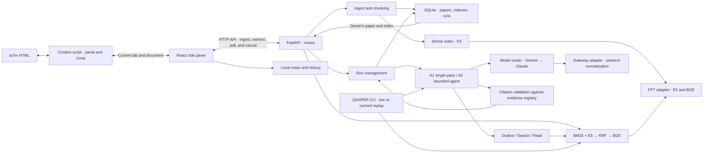

# PaperLens Source Architecture

PaperLens is a Manifest V3 Chrome extension with a React and TypeScript side panel and a FastAPI backend. Readers can analyze arXiv HTML pages, ask questions about the open paper, inspect citations, and save notes. The QASPER CLI evaluates the same chunking, retrieval, and agent code. This scaffold is at the specification stage.

The MVP scope, limits, and interfaces follow the v4.1 plan. The draft PDF describes paragraph lineage, hybrid retrieval, and the bounded agent. Answer quality, semantic citation support, and latency require measurements from a running system. [v4.1 plan](../PaperLens_Research_Project_Plan.md), [PaperLens draft](../PaperLens_Arxiv_Paper.pdf)



## Directory tree

An asterisk marks a file to declare during extension packaging. Each source file begins with a block describing its responsibilities and implementation constraints.

```text
PaperLens/
├── .env                                       # Local backend configuration, ignored by Git
├── .env.example                               # Public template with the backend variable names
├── .gitignore                                 # Excludes local configuration and generated files
├── PaperLens_Research_Project_Plan.md           # v4.1 scope, protocol, and roadmap
├── PaperLens_Arxiv_Paper.pdf                    # Methodology draft
├── pyproject.toml                              # Python packaging, dependencies, and test configuration
├── docs/
│   ├── architecture.md                         # File tree, data flow, and responsibilities
│   ├── fpt_api_contract.md                     # API contract for each FPT model
│   └── llm_gateway_contract.md                 # Generation, tool, and usage contracts by alias
├── extension/
│   ├── manifest.json *                         # Manifest V3, entry points, and Chrome permissions
│   ├── package.json *                          # React, TypeScript, esbuild, and build commands
│   ├── tsconfig.json *                         # TS/TSX and Chrome API type checking
│   ├── build.mjs                               # Bundle three entry points and copy the manifest and HTML
│   ├── src/
│   │   ├── messages.ts                         # Message types for the side panel and content script
│   │   ├── background/
│   │   │   └── index.ts                        # Open the side panel from the toolbar
│   │   ├── content/
│   │   │   ├── index.ts                        # Handle context, Analyze, and Jump requests
│   │   │   ├── parser.ts                       # Identify pages and extract outlines and paragraphs
│   │   │   └── navigation.ts                   # Fingerprint paragraphs and verify the target before Jump
│   │   ├── api/
│   │   │   ├── types.ts                        # FastAPI request and response types
│   │   │   └── client.ts                       # Call FastAPI from the side panel with the session token
│   │   └── sidepanel/
│   │       ├── index.html                      # Chrome side panel page
│   │       ├── main.tsx                        # React entry point
│   │       ├── App.tsx                         # Paper question interface, states, and actions
│   │       ├── usePaper.ts                     # Active tab, consent, ingest, and index polling
│   │       ├── useAgentRun.ts                  # Start, monitor, and cancel question runs
│   │       ├── Answer.tsx                     # Answer blocks and citation links
│   │       ├── EvidenceList.tsx               # Quotes, sections, Jump, and Save
│   │       ├── library.ts                     # History, local notes, and Markdown export
│   │       └── styles.css                     # Side panel styles and citation highlights
│   └── tests/
│       ├── arxiv_dom.test.ts                   # Parser, anchors, fingerprints, and section fallback
│       └── sidepanel.test.ts                   # Consent, tab changes, polling, cancel, save, and export
├── backend/
│   ├── app/
│   │   ├── main.py                            # FastAPI app, resource lifecycle, and health endpoint
│   │   ├── ingest.py                          # Validate papers, hash content, and index passages
│   │   ├── routes/
│   │   │   ├── papers.py                     # Ingest, inspect status, and delete papers
│   │   │   ├── retrieve.py                   # Standalone evidence retrieval endpoint
│   │   │   ├── agent.py                      # Start, inspect, and cancel agent runs
│   │   │   └── session.py                    # User session state and quota
│   │   ├── core/
│   │   │   ├── config.py                     # Load settings by environment and run mode
│   │   │   ├── schemas.py                    # Paper, Section, Passage, EvidenceResult, and HTTP DTOs
│   │   │   ├── db.py                         # SQLite schema, connections, and transactions
│   │   │   ├── security.py                   # Authentication and owner identity
│   │   │   └── limits.py                     # Input limits, quotas, and budget reservations
│   │   ├── providers/
│   │   │   ├── fpt.py                        # Adapter for E5 embeddings and BGE reranking
│   │   │   └── llm_gateway.py                # Normalize gateway requests and responses
│   │   ├── retrieval/
│   │   │   ├── chunking.py                   # Split long paragraphs and preserve the parent ID
│   │   │   ├── bm25.py                       # Index and rank passages lexically within one paper
│   │   │   ├── dense.py                      # E5 inputs, vectors, and cosine ranking
│   │   │   └── hybrid.py                     # B1–B4 selection, RRF, reranking, and parent grouping
│   │   ├── agent/
│   │   │   ├── runs.py                       # Store runs, track progress, cancel, and handle retries
│   │   │   ├── controller.py                 # Bounded A2 tool loop
│   │   │   ├── single_pass.py                # A1 retrieval followed by answer generation
│   │   │   ├── model_router.py               # Gemini first with Claude fallback within the turn
│   │   │   ├── tools.py                      # Three read-only tools for the authorized paper
│   │   │   ├── schemas.py                    # Actions, observations, answer blocks, and agent DTOs
│   │   │   ├── prompts.py                    # Versioned prompts and citation instructions
│   │   │   └── citations.py                  # Run evidence registry and citation ID validation
│   │   ├── cache/
│   │   │   └── paper_store.py                # Papers, passages, vectors, and index status
│   │   └── telemetry/
│   │       └── usage.py                      # Latency, usage, cost, and errors for each attempt
│   └── tests/
│       ├── test_paper_routes.py               # Ownership, ingest, status, and data deletion
│       ├── test_retrieval.py                  # B1–B4, parent deduplication, and lexical fallback
│       └── test_agent_runs.py                 # Deadline, failover, citations, cancel, and retries
├── research/
│   ├── datasets/
│   │   └── qasper.py                          # Load splits and map gold evidence to paragraphs
│   ├── evaluation/
│   │   ├── run_eval.py                        # B1–B4 or A1/A2 evaluation CLI with provenance
│   │   ├── metrics.py                         # Retrieval metrics and paired bootstrap by paper
│   │   ├── qa_audit.py                        # Answer rubric, citation support, and abstention
│   │   └── replay.py                          # Provider adapters for offline replay from artifacts
│   └── tests/
│       └── test_evaluation.py                 # Mapping, denominators, benchmarks, and replay
├── configs/
│   ├── product_mvp.yaml                       # Product runtime configuration
│   ├── baseline.yaml                          # QASPER B1–B4 configuration
│   └── agent_qa.yaml                          # Gemini-only A1/A2 configuration
├── scripts/
│   ├── smoke_test_fpt.py                      # Verify E5 and BGE contracts with small inputs
│   ├── smoke_test_llm_gateway.py              # Verify generation, tools, and usage by alias
│   ├── prepare_qasper.py                      # Prepare the dataset manifest and audit evidence mapping
│   └── export_results.py                      # Export tables from identified evaluation runs
└── artifacts/
    └── README.md                              # Manifest, checksums, traces, and distribution rights
```

## Source file conventions

- Python modules start with a `"""..."""` docstring. Use a summary line, a blank line, and the detailed description. [PEP 257](https://peps.python.org/pep-0257/#multi-line-docstrings)
- TypeScript, TSX, and JavaScript use `/** ... */`. CSS uses `/* ... */`, and HTML uses `<!-- ... -->`. [ECMAScript lexical grammar](https://tc39.es/ecma262/multipage/ecmascript-language-lexical-grammar.html#sec-comments)
- YAML and TOML group descriptions into `#` comments. The JSON files marked with an asterisk have names and purposes in the tree and are added during packaging. [YAML comments](https://yaml.org/spec/1.2.2/#66-comments), [TOML comments](https://toml.io/en/v1.0.0#comment)

## Module dependencies

- `main.py` initializes resources and registers routes. Routes authenticate requests, load owner-scoped data, and delegate to `ingest.py`, `retrieval/hybrid.py`, or `agent/runs.py` according to the endpoint.
- `runs.py` owns the HTTP run lifecycle. `controller.py` and `single_pass.py` receive a loaded paper and return pipeline results. `model_router.py` decides when to switch models. `llm_gateway.py` normalizes each gateway request and response.
- The QASPER CLI imports chunking, retrieval, and agent modules from `backend.app` and supplies adapters for the selected mode. The benchmark loads data into memory. The product runtime initializes FastAPI and SQLite.

## Data flow and contracts

### Analyze and index a paper

1. `usePaper.ts` obtains the tab context through a message. Abstract pages offer the HTML link present on the page. On supported HTML pages, **Analyze this paper** confirms consent to send passages before invoking `parser.ts`. The content script returns sections, paragraphs, the canonical URL, the version when known, and locators. Missing versions have an explicit state.
2. The side panel calls ingest. `ingest.py` validates the source, size, and structure, hashes the content on the server, and creates or reuses an owner-scoped paper. `chunking.py` retains the original paragraph and splits long passages under the E5 budget, targeting 400 tokens including the prefix. Each subchunk retains `parent_passage_id` and text offsets. QASPER uses the same chunker with dataset-specific source locations.
3. `paper_store.py` stores paragraphs and index progress by owner. `lexical_ready` makes BM25 available. `semantic_ready` confirms that all vectors for the applicable configuration are ready. SQLite persists data and state so incomplete batches can resume. If dense indexing fails, BM25 remains available once the lexical index is ready.

A paper has an opaque server-assigned `paper_id`, arXiv ID and version, parser version, canonical URL, and content hash. Embedding caches are keyed by owner, content hash, parser and chunking versions, embedding model and snapshot, and prefix. A `Passage` contains its section ID and path, paragraph order, ID and parent ID, text, and source location. The source-location contract supports `html_dom` and QASPER variants. The `html_dom` variant carries the data required for Jump.

### Retrieve evidence, generate answers, and open sources

1. `hybrid.py` selects B1 BM25, B2 E5, B3 RRF, or B4 RRF + BGE. The product defaults to B4 when the semantic index is ready. B4 takes up to 40 chunks from each BM25 and E5 ranking, fuses them with RRF, reranks up to 20 question-passage pairs, and keeps the best hit per parent. By default, the UI receives up to 5 parent paragraphs. Lexical fallback results include `retrieval_mode` and `fallback_reason`. E5 uses `query: ` and `passage: ` consistently across both runtimes.
2. `runs.py` creates a turn with a `run_id` tied to the owner, paper version, and `request_id`. A retry with the same owner, request ID, and payload returns the existing run. Reusing a request ID with a different payload returns a conflict. The side panel polls and can cancel the run. It keeps the run ID by tab, document, and session so it can reconnect within the same Chrome session. Runs interrupted by a restart are finalized with an appropriate status and unknown billing recorded when applicable.
3. `controller.py` coordinates A2. The model selects `get_paper_outline`, `search_evidence`, or `read_section`, receives an observation, and chooses the next step. `tools.py` validates arguments and uses the paper assigned to the turn by the backend. `single_pass.py` implements A1 using the same answer schema, router, and validator.
4. `model_router.py` prefers `ag/gemini-3.8-flash-medium` and switches to `ag/claude-sonnet-4-6` at most once for an eligible error when budget remains. Following a switch, Claude uses the existing observations for the rest of the turn. A new turn starts with Gemini. The router uses normalized gateway errors and validation of the current step's output.
5. `citations.py` checks each `evidence_id` against the turn registry. The registry contains text and locators from sources the backend read for the owner and paper version. Responses obtain their evidence from the registry. If an answer is partly valid or the budget is exhausted, the backend returns `partial` or `evidence_only` with the reason and available evidence. The `completed` state requires a valid final answer.
6. `Answer.tsx` links citations to evidence cards. On Jump, `navigation.ts` verifies the tab and document, tries the element ID or a selector established by the parser, and checks the current paragraph's fingerprint. If the paragraph cannot be verified, the UI offers a section link when available. The side panel applies responses only when they match the current tab, document, and request.

Each turn allows up to 3 logical LLM steps, 4 provider attempts, 4 tool calls, 2 searches, and 8 parent passages. The shared deadline is 30 seconds. Initial timeouts are 10 seconds for Gemini and 12 seconds for Claude, capped by the remaining time. The final step is reserved for the answer. Each turn retains at most 3 prior turns from the current paper. The input/output budgets are 16,000/2,400 tokens across all attempts, with a final-answer cap of 800 tokens. Cancellation or deadline expiry prevents further steps. Discard late responses based on run state.

### HTTP interface

| Method and path | Owner module | Main behavior |
| --- | --- | --- |
| `GET /api/v1/health` | `main.py` | Backend version and health |
| `GET /api/v1/session` | `routes/session.py` | Authenticated session and quota |
| `POST /api/v1/papers/ingest` | `routes/papers.py` | Return the paper ID and index status, with HTTP 202 while processing |
| `GET /api/v1/papers/{paper_id}/status` | `routes/papers.py` | Lexical and semantic readiness and indexing errors |
| `DELETE /api/v1/papers/{paper_id}` | `routes/papers.py` | Delete the owner's paper, index, and derived data |
| `POST /api/v1/retrieve` | `routes/retrieve.py` | Return evidence, ranks, and retrieval mode |
| `POST /api/v1/agent/runs` | `routes/agent.py` | Return HTTP 202 and the run ID for polling |
| `GET /api/v1/agent/runs/{run_id}` | `routes/agent.py` | Progress or answer blocks, citations, and evidence |
| `POST /api/v1/agent/runs/{run_id}/cancel` | `routes/agent.py` | Request cancellation of the owner's run |

Data routes authenticate requests and enforce owner-scoped access. The UI tracks the result using `request_id`, `paper_id`, and `run_id`. Run states are `queued`, `running`, `completed`, `partial`, `evidence_only`, `cancelled`, and `failed`. Final responses carry answer blocks, evidence, the serving model, and the fallback reason when applicable.

The side panel discloses the data sent during Analyze and Ask. The backend and FPT receive passages, and the gateway receives questions, history, and evidence for Gemini or Claude. The backend holds the FPT and gateway API keys. Closed beta uses individual revocable tokens. Public access uses tokens from a verified managed OTP provider. `core/limits.py` reserves quota and budget in a transaction before inference and reconciles usage afterward. Product telemetry retains the minimum operational metadata.

### QASPER evaluation

`research/datasets/qasper.py` converts the pinned official QASPER v0.3 splits to `Paper` and `Passage`. The evaluator uses `EvidenceLabel` and reference sets. The CLI calls the shared chunking, retrieval, and agent modules with data loaded into memory. QASPER and HTML sources use the same pipeline. Each question is scoped to its paper.

B1–B4 measure retrieval over unique parents. The main A1/A2 comparison uses the same Gemini snapshot, B4 configuration, budgets, and questions. A1 retrieves at most 8 parents in one B4 pass. A2 collects at most 8 parents across tool observations. The benchmark uses `primary_only` and records Gemini failures. Separate reliability tests cover failover. Automated citation ID checks are paired with manual audits of claim support and answer completeness.

`run_eval.py` takes an explicit configuration and either `live` or `replay` mode. Replay uses a pinned local tokenizer and adapters that read saved vectors, rerank scores, and LLM observations. The loader checks the manifest and reports missing or mismatched artifacts. Provider latency measurements come from eligible live runs. The parser and Jump have separate HTML fixtures.

## Planned entry points and packaging

- Run the backend from the repository root with `python -m uvicorn backend.app.main:app`. `main.py` manages a bounded task pool within one process through FastAPI lifespan. `runs.py` and `ingest.py` persist recoverable state. Provider calls run outside SQLite transactions. [FastAPI lifespan](https://fastapi.tiangolo.com/advanced/events/)
- `.env` and `.env.example` sit together in the repository root. The backend uses `API_URL` and `API_KEY` for the retrieval API and `LLM_API_URL` and `LLM_API_KEY` for the LLM gateway. Git ignores `.env` and tracks the template with blank values. [Backend configuration template](../.env.example)
- The extension uses esbuild with three entry points, `src/background/index.ts`, `src/content/index.ts`, and `src/sidepanel/main.tsx`. `build.mjs` produces `dist/background.js`, a self-contained `dist/content.js`, and `dist/sidepanel/main.js`, then copies the HTML, CSS, and manifest. `manifest.json` points to the worker, content bundle, and `sidepanel/index.html`. [esbuild bundle](https://esbuild.github.io/api/#bundle), [Chrome Side Panel](https://developer.chrome.com/docs/extensions/reference/api/sidePanel)
- The manifest registers the content script on `https://arxiv.org/html/*` and `https://arxiv.org/abs/*`. Extension permissions include `sidePanel`, `storage`, and the backend host permission for the environment. The side panel sends API requests from the extension origin. The content script exchanges messages and works with the DOM of the active tab. [Chrome content scripts](https://developer.chrome.com/docs/extensions/develop/concepts/content-scripts), [Chrome network requests](https://developer.chrome.com/docs/extensions/develop/concepts/network-requests)
- Run the benchmark from the repository root with `python -m research.evaluation.run_eval`. Run helper scripts with `python -m scripts.<module_name>`. When packaging with `pyproject.toml`, discover the `backend.app` and `research` namespace packages and their application subpackages. [PEP 420](https://peps.python.org/pep-0420/#specification), [setuptools namespace discovery](https://setuptools.pypa.io/en/latest/userguide/package_discovery.html#finding-namespace-packages)
- `package.json` declares dependencies and the build, type-check, and test commands. `tsconfig.json` sets TS/TSX options, Chrome types, and type checking. The three JSON files are specified in this document during the comment-only stage.

## Implementation and verification order

- Start with **Analyze → BM25 → Evidence → Jump**. Connect `usePaper.ts` to `content/parser.ts` through content-script messages, then ingest the paper through `routes/papers.py` → `ingest.py`. For B1, `routes/retrieve.py` calls `retrieval/hybrid.py` to use BM25. Show evidence through `EvidenceList.tsx` and open the verified paragraph through `content/navigation.ts`. Test abstract pages with an HTML link, missing sources, tab or version changes, and fingerprint mismatches.
- Once the BM25 flow works, add `dense.py` and `providers/fpt.py`, then extend `hybrid.py` for B2–B4. Use the same retrieval engine in `research/evaluation/run_eval.py`.
- Complete `agent/single_pass.py` and `agent/citations.py` for cited answers before assembling `agent/controller.py`, `agent/tools.py`, and `agent/model_router.py` into the A2 loop.
- Verify FPT endpoints, authentication, request and response schemas, batch limits, and usage per model. Verify each gateway alias, tool round trips, output schemas, usage, and handoff before enabling fallback. [FPT contract](fpt_api_contract.md), [gateway contract](llm_gateway_contract.md)
- API and agent tests cover ownership, request retries, cancellation, provider timeouts, unknown usage, citations outside the registry, and late responses. Evaluator tests cover multiple reference sets, duplicate parents, and missing replay data.
- `docs/privacy.md`, `docs/release_checklist.md`, and `.github/workflows/ci.yml` follow the milestones in the release plan. Reports in `reports/` use runs with manifests.
